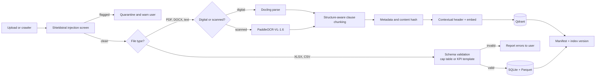
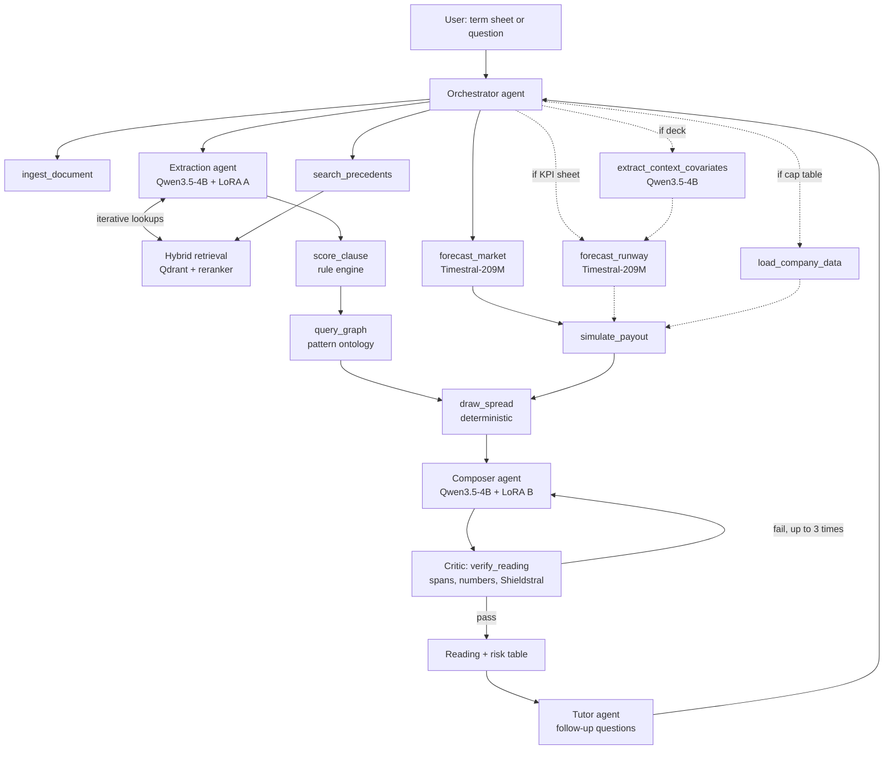
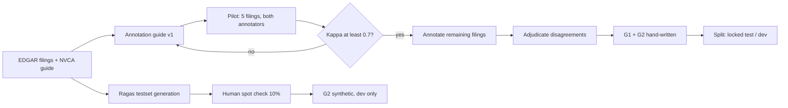
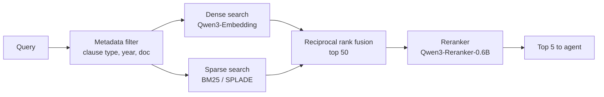
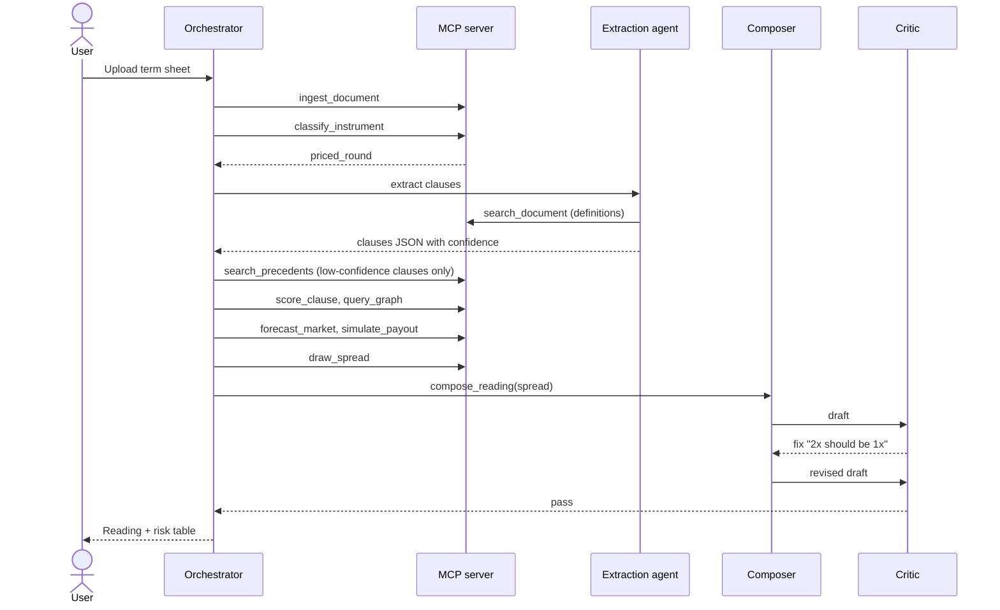
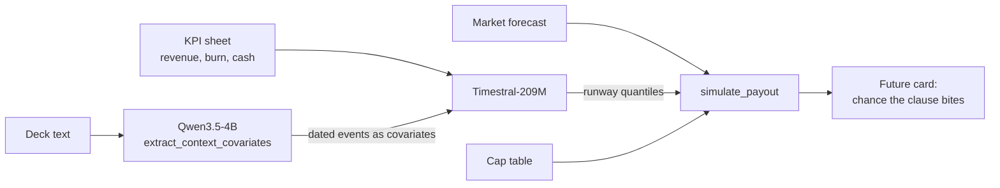
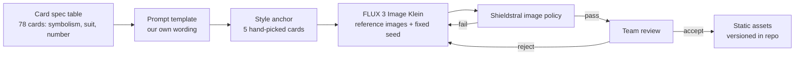
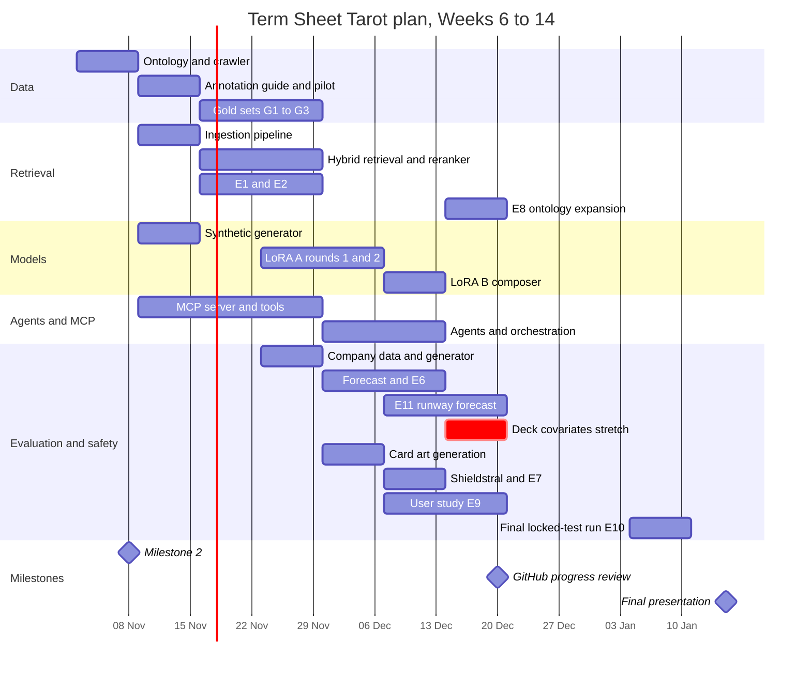

# Term Sheet Tarot: Architecture and Project Plan

**Milestone 2 · Week 6 · Last updated 1 November 2026**

This document turns the Term Sheet Tarot RFC into a system we can build and evaluate. For each part of the system it states the design choice, the alternatives we considered, and why we chose this one. Every model and method below was checked against releases and published results available on 1 November 2026.

## Contents

1. [Problem and data](#1-problem-and-data)
2. [System overview](#2-system-overview)
3. [Golden dataset](#3-golden-dataset)
4. [RAG design](#4-rag-design)
5. [Agent, tools and MCP server](#5-agent-tools-and-mcp-server)
6. [Model choices](#6-model-choices)
7. [Evaluation plan](#7-evaluation-plan)
8. [Plan and timeline](#8-plan-and-timeline)
9. [Risks](#9-risks)
10. [Changes since the RFC](#10-changes-since-the-rfc)
11. [References](#11-references)

---

## 1. Problem and data

### 1.1 Task

The system takes a venture-capital term sheet and produces two outputs that always appear together:

- **A plain risk table**: every extracted clause with its type, key attributes, a 0–100 risk score, a comparison with the market benchmark, and the exact source span.
- **A three-card tarot reading**: one card each for Economics, Control and Future. The card, its number and its orientation are computed deterministically from the risk table; a language model only writes the explanatory paragraph, which must quote the source.

After the reading, the user can ask follow-up questions ("Why is the Tower reversed?", "Is a 1.5x preference normal?"). The research question is whether the reading helps non-experts understand and remember risks better than the table alone.

### 1.2 Inputs

A term sheet says what the deal is, but not how likely each clause is to matter. A 2x liquidation preference is harmless at a $500M exit and decisive at a $30M one, and which of those is likely depends on the company. The system therefore accepts optional company documents that make the forecast specific to the company instead of only to the market.

| Input | Status | Format | What it changes |
| --- | --- | --- | --- |
| Term sheet | **Required** | PDF, DOCX, text | Clause extraction, risk table, the three cards |
| Cap table | Optional | XLSX or CSV (template provided) | Payout simulation shows money per holder instead of percentages; existing preferences stack with the new ones |
| Monthly KPI sheet | Optional | XLSX or CSV: month, revenue, burn, cash | Timestral forecasts the company's runway; the Future card reflects the chance of needing money in a weak market |
| Pitch deck or investor update | Stretch | PDF or text | Planned events (raise date, hiring, launch) become forecast covariates |

What the user provides decides what runs: with only a term sheet, the Future card uses the market forecast; with a KPI sheet it adds the company's runway; with a deck it adds text-derived covariates. Each optional input has a clear, measurable effect, and a reading without it is still complete.

General business documents (audited statements, 10-Ks, news) are out of scope: they would need their own parsers, schemas and test data without changing the three cards.

**Scope.** Priced-round term sheets (Seed, Series A) are the core. Post-money SAFEs are a stretch goal. Convertible notes and anything framed as legal advice are out of scope. The user study (E9) uses term sheets only, so the comparison between the reading and the plain table stays clean.

### 1.3 Datasets

| ID | Source | Content | Role in the system | Size target |
| --- | --- | --- | --- | --- |
| D1 | NVCA Model Legal Documents | Model term sheet, charter, investors' rights and voting agreements, with alternative clause language and footnotes | Clause ontology, synthetic generator, annotation guide | 1 document set |
| D2 | SEC EDGAR, S-1 exhibits | Real restated certificates of incorporation and investors' rights agreements filed by companies going public | Precedent index and the real test set | ~300 filings indexed, 30 for the gold set |
| D3 | Series Seed, Techstars and YC SAFE templates | Seed-stage model documents | Extra clause variants; SAFE schema (stretch) | ~10 documents |
| D4 | Synthetic term sheets | Generated from D1 alternatives, paraphrased by an open model so the extractor cannot memorise template wording | Fine-tuning data only, never test data | ~3,000 documents |
| D5 | Public quarterly venture reports | Median valuations by stage, down-round share, share of deals with participating preferences or full ratchets | Forecast series for Timestral | 10–15 series, a few dozen quarters each |
| D6 | CUAD | 510 expert-annotated commercial contracts | External sanity check for the extractor | Test subset only |
| D7 | Synthetic companies | Each company has a cap table, 24–36 months of KPIs, a short deck text with planted events, and a known continuation of its series | Training and testing the company forecast (G7) | ~500 companies |
| D8 | S-1 historical financials | Quarterly revenue and cash flow that S-1 filers report for the years before going public | Real-data check for the runway forecast | ~50 companies, 8–12 quarters each |

**Why EDGAR.** Real term sheets are confidential. The definitive documents filed with S-1 registrations contain the same clauses (liquidation preference, anti-dilution, board composition, drag-along, protective provisions) in real negotiated wording, and they are public. That makes them the only realistic source of real test data a student team can get. The same filings also report several years of pre-IPO financials (D8), which gives the forecast a real check.

**Why synthetic companies.** No public dataset pairs a startup's term sheet with its KPIs, deck and later outcome. D7 fills that gap the way the Context is Key benchmark does: each deck mentions events (a planned raise, a hiring push, a delayed launch) whose effect is built into the company's future series, so a forecast can only get them right by reading the text. This tests whether the covariates help; D8 shows whether the forecaster works on real company histories. We report the two separately and state the synthetic limitation.

### 1.4 Ingesting new data

New data arrives in four ways:

1. **User upload, documents**: a term sheet or deck (PDF, DOCX or text), through `ingest_document`.
2. **User upload, structured data**: a cap table or KPI sheet (XLSX or CSV), through `load_company_data`.
3. **Precedent batch**: new EDGAR filings fetched by a scheduled crawler job, or a folder of documents added by a team member.
4. **Market update**: a new quarter of venture data appended to the D5 series.



Cap tables and KPI sheets are not embedded: they are numbers, so they are validated against a fixed schema (Pydantic models with unit and date checks) and stored as tables. A file that does not match the template is rejected with a list of the problems rather than guessed at.

Design rules for ingestion:

- **Idempotent.** Every chunk carries a content hash, so re-ingesting a file never creates duplicates.
- **Versioned.** Each ingestion writes a manifest (corpus snapshot ID, parser version, embedding model version). Evaluation results always cite the snapshot they ran on, so a retrieval regression can be traced to a corpus or model change.
- **Untrusted by default.** Uploaded text is data, never instructions. Shieldstral screens it before indexing, and nothing inside a document can change the agent's behaviour.
- **No retraining needed.** New precedents become searchable immediately; only the extractor's fine-tuning data is fixed.

---

## 2. System overview

The design follows the pattern that performs best in 2026 document-analysis and forecasting research: a fine-tuned language model **reads**, deterministic code **judges**, a time-series foundation model **forecasts**, and a grounded composer **narrates**, with a verifier between generation and the user. No component predicts something another component computes, which keeps the system testable and prevents the narrative from drifting from the source.



| Layer | Components | Deterministic? |
| --- | --- | --- |
| Agents (LLM) | Orchestrator, Extraction, Composer, Critic, Tutor | No |
| Tools (code) | Rule engine, graph queries, spread selection, payout simulation, span/number verifier | Yes |
| Models as tools | Embeddings, reranker, Shieldstral, Timestral, parser | Model output, fixed weights |
| Storage | Qdrant (vectors + payload), SQLite (documents, extractions, cap tables, runs), Parquet (market and KPI series) | — |

Dotted arrows are paths that run only when the user provides the matching optional input (§1.2).

---

## 3. Golden dataset

### 3.1 Principles

Published practice in 2026 is consistent on four points, and we adopt all four:

1. **Hand-written beats synthetic for the gate set.** A small set of questions written and answered by people who read the source is a better judge of a RAG system than a large synthetic set, which tends to reward the generator that wrote it. Synthetic questions are useful as a larger regression harness for retrieval, after a human spot check.
2. **Every row carries evidence**, not just a question and an answer: the supporting chunk IDs and character spans, so retrieval and generation can be scored separately.
3. **A locked test set and a separate dev set.** Engineers may inspect dev failures; nobody tunes on the test set.
4. **Everything is versioned together**: `dataset_version + corpus_snapshot + annotation_guide_version`.

### 3.2 Components

| Set | What it tests | How it is built | Size |
| --- | --- | --- | --- |
| G1 Extraction | Clause spans, types, attributes | Two team members annotate 30 EDGAR filings with the NVCA footnotes as the guide; disagreements adjudicated; Cohen's κ reported | ~150 clauses (5 core types × ~30) |
| G2 Question answering | Retrieval + grounded answers | Hand-written questions with expected answer, supporting spans and question type | 200 hand-written + ~500 synthetic (dev only) |
| G3 Readings | End-to-end spread correctness | 40 term sheets (25 controlled synthetic, 15 real-derived) with expected cards, numbers and orientation, checked by annotators | 40 |
| G4 Agent scenarios | Tool choice and task success | Scripted requests with the expected tool sequence and outcome | 30 |
| G5 Safety | Guardrails and verifier | ~50 seeded examples per Shieldstral policy; 100 paragraphs with planted factual errors for the verifier | ~350 |
| G6 Market forecast backtest | Timestral on market series | Rolling-origin holdout on the D5 series | Last 4–6 quarters per series |
| G7 Company forecast | Runway forecast, with and without deck covariates | D7 synthetic companies with a known continuation (locked 100-company test split); D8 S-1 histories as the real check | 100 synthetic + ~50 real |

### 3.3 G2 question mix

The question types are stratified so that one easy type cannot dominate the score:

| Type | Example | Share |
| --- | --- | --- |
| Factoid | "What is the liquidation preference multiple, and is it participating?" | 30% |
| Comparison with benchmark | "Is this anti-dilution clause more investor-friendly than the NVCA default?" | 20% |
| Multi-hop | "Can investors force a sale without the common holders, given the board composition?" | 20% |
| Precedent | "How common is a full ratchet among the indexed filings?" | 15% |
| Unanswerable | "What is the company's revenue?" (not in the document) | 15% |

Unanswerable questions test that the system says "not in the document" instead of inventing an answer, which is the hallucination case that matters most here.

### 3.4 Construction pipeline



**Row schema (G2)**

```json
{
  "id": "g2-0142",
  "question": "Is the Series A preference participating?",
  "question_type": "factoid",
  "document_id": "edgar-0001234567-exh3-1",
  "expected_answer": "No. It is a 1x non-participating preference.",
  "supporting_spans": [{"chunk_id": "c-8812", "start": 1043, "end": 1297}],
  "answerable": true,
  "dataset_version": "g2-v1.0",
  "corpus_snapshot": "snap-2026-11-20"
}
```

**LLM judge.** Answer correctness and faithfulness on G2 are scored by an open model that is not the model under test (Qwen3.6-27B, 4-bit quantised, run offline in batch so it never competes with the serving stack). Before we trust it, two team members grade 50 answers blind; if the judge agrees with them on fewer than 9 in 10, we fix the judge prompt first.

---

## 4. RAG design

### 4.1 What retrieval is for

Retrieval serves three jobs, each with different needs:

| Job | Query | Needs |
| --- | --- | --- |
| Extraction lookups | "Where is 'Original Issue Price' defined in this document?" | Exact, within one document, follows cross-references |
| Precedent search | "Comparable full-ratchet clauses" | Across filings, filtered by clause type and year |
| Follow-up answers | User questions in the Tutor | Mixed: the uploaded document plus precedents |

### 4.2 Chunking

**Choice: structure-aware clause chunking, with recursive 512-token splitting as the fallback and a short contextual header on each chunk.**

Legal documents already have the structure we need: articles, sections and numbered clauses. Each chunk is one clause (or sub-clause), split recursively only if it exceeds 512 tokens, with no overlap by default. Each chunk is prefixed with a deterministic header: document type, section path, and the defined terms it uses (e.g. *"Certificate of Incorporation › Article IV › B.2 Liquidation Preference. Uses: Original Issue Price, Deemed Liquidation Event."*).

**Rationale.**

- Recursive splitting at 512 tokens is the benchmark-validated default; in one 2026 benchmark it beat semantic chunking on end-to-end accuracy (69% vs 54%), largely because semantic chunking produced fragments that were too small.
- No single chunking strategy wins everywhere, so we compare strategies on our own data instead of assuming.
- Contracts are full of cross-references, the case where contextual retrieval helps most. Full LLM-written context per chunk is expensive, so our default header is built deterministically from the parsed structure, and the LLM-generated version is one of the variants we test.

**Variants compared (experiment E1):**

| Variant | Description |
| --- | --- |
| C0 | Recursive 512 tokens, no structure (baseline) |
| C1 | Clause-aware chunks |
| C2 | C1 + deterministic contextual header (default) |
| C3 | C1 + LLM-written context sentence (Qwen3.5-4B) |
| C4 | C1 + late chunking |

### 4.3 Embedding model

**Choice: Qwen3-Embedding-0.6B as the default; Qwen3-Embedding-4B and BGE-M3 as challengers.**

- The Qwen3-Embedding family leads open multilingual retrieval on MTEB, supports 32K-token inputs (whole clauses never truncate), flexible output dimensions and task instructions, and is Apache 2.0.
- 0.6B leaves GPU memory for the reader and guard models; we move to 4B only if E2 shows a meaningful recall gain on G2.
- BGE-M3 produces dense, sparse and multi-vector representations from one model, which makes it the natural comparison for hybrid search.

Leaderboard scores are only a starting point; the winner is whichever gives the best Recall@10 on our G2 dev set.

### 4.4 Vector database

**Choice: Qdrant, self-hosted in Docker.**

| Option | Why not chosen |
| --- | --- |
| pgvector | Good when vectors are a feature of an existing Postgres app; we have no Postgres, and hybrid search needs hand-rolled fusion |
| Chroma | Simplest to start with, but hybrid search is less mature |
| Milvus | Built for hundreds of millions of vectors; operational overhead with no benefit at our scale (~10⁵ chunks) |
| Weaviate | Strong native hybrid search; a reasonable alternative, but heavier to run |

Qdrant fits because:

- **Payload filtering is fast and central to our queries**: almost every precedent search filters by clause type, year or filing.
- It stores **dense and sparse vectors in the same collection** and fuses them server-side, so hybrid search needs no extra service.
- It is open source, free to self-host, and the common self-hosted default for production RAG in 2026.

The pattern ontology is small (tens of nodes, rules defined in code), so it lives in Python with NetworkX; a graph database would add operations without adding capability.

### 4.5 Retrieval pipeline

**Choice: hybrid dense + sparse retrieval with reciprocal rank fusion, metadata filters, then a cross-encoder reranker; agentic two-stage retrieval for precedents.**



- **Hybrid + reranker is the 2026 production default** because it gives the best quality gain for its cost; legal text needs the lexical half because defined terms ("Deemed Liquidation Event") must match exactly.
- **Reranker:** Qwen3-Reranker-0.6B and BGE-reranker-v2-m3 score about the same on BEIR at the same size, so E2 decides between them on our data.
- **Agentic two-stage retrieval for precedents**: first pick the filing, then the passage. Financial-document research shows models choose the right document well but struggle to find the exact passage, and that splitting the two steps helps.
- **Iterative retrieval inside extraction**: when a clause refers to a defined term, the Extraction agent looks up the definition before finalising attributes. A 2026 controlled study on CUAD found this produces more complete clause text than reading a fixed set of chunks.

### 4.6 Graph: why not GraphRAG

We do not build an LLM-extracted knowledge graph (Microsoft GraphRAG or LightRAG). Published comparisons show graph RAG pays off mainly for multi-hop questions across large corpora, at a high indexing cost, and practitioner tests of LightRAG on real data have been mixed. Our multi-hop needs are narrow and known in advance (combinations like "full ratchet + no pay-to-play"), so they are encoded as a **hand-built pattern ontology** queried by `query_graph`. The ontology is also used for query expansion: a question about "drag-along" also retrieves board-composition clauses. Experiment E8 measures whether this expansion helps.

### 4.7 RAG experiments

| ID | Variant | Change from previous |
| --- | --- | --- |
| R0 | Dense only | Baseline |
| R1 | Hybrid + RRF | Adds sparse search |
| R2 | R1 + reranker | Adds cross-encoder |
| R3 | R2 + best chunking from E1 | Chunking |
| R4 | R3 + agentic two-stage / iterative | Agent controls retrieval |
| R5 | R4 + ontology query expansion | Graph |

Metrics: Recall@5, Recall@10, nDCG@10 and MRR on G2 (retrieval); correctness, faithfulness and correct refusal on unanswerable questions (generation); latency per query.

---

## 5. Agent, tools and MCP server

### 5.1 Decisions the agent makes

The agent layer exists because these choices depend on the input and cannot be fixed in advance:

| Decision | Inputs | Options |
| --- | --- | --- |
| Which pipeline to run | Instrument type from `classify_instrument` | Priced round, SAFE, or unsupported (return clause list only) |
| Whether to search precedents | Extraction confidence, non-standard flag | Skip, or run two-stage search for that clause |
| Which inputs to use | Which optional files were uploaded and passed validation | Term sheet only; + cap table (exact payouts); + KPI sheet (runway forecast); + deck (text covariates) |
| Which forecast to run | Future position drawn; KPI series length and gaps | Market forecast only, or market + company runway; falls back to market only if the KPI series is too short (under 12 months) |
| Whether to follow a cross-reference | Undefined term in a clause | Look up definition, or proceed |
| What to do after a failed check | Critic report | Regenerate with the failing claim named, or fall back to the template |
| How to route a follow-up | User intent | Rules, graph, precedent search, or explanation |
| Whether to answer at all | Shieldstral policy scores | Answer, rephrase without advice, or decline |

### 5.2 Agents

Four agents are core; three more start as plain tools and become agents only if time allows.

| Agent | Model | Job |
| --- | --- | --- |
| Orchestrator | LFM3-1.7B or Qwen3.5-4B (decided by E4) | Classifies the request, plans and routes tool calls |
| Extraction | Qwen3.5-4B + LoRA A | Reads clauses into JSON; follows cross-references |
| Composer + Critic | Qwen3.5-4B + LoRA B; Critic is code + Shieldstral | Writes card paragraphs; Critic checks and sends targeted fixes |
| Tutor | Same base as Orchestrator | Answers follow-up questions |
| *Intake, Precedent, Market* | — | Tools in the MVP; promoted to agents if E4 shows a benefit |

**Framework: PydanticAI.** Tools and outputs are typed Pydantic models, validation and retries are built in, it is model-agnostic, and it talks to locally served models through any OpenAI-compatible endpoint. Its v1 release in April 2026 made it a stable choice, and it is lighter than LangGraph for a small set of well-defined agents. If the Composer–Critic loop needs durable state, we add a LangGraph node around it; PydanticAI agents drop into LangGraph nodes without a rewrite.

### 5.3 A reading request, step by step



### 5.4 Tools

| Tool | Input → output | Implementation |
| --- | --- | --- |
| `ingest_document` | file → document_id, manifest | Pipeline in §1.4 |
| `classify_instrument` | document_id → type + confidence | Qwen3.5-4B, LoRA A, constrained output |
| `extract_clauses` | document_id → clauses JSON | Qwen3.5-4B, LoRA A, JSON-schema constrained |
| `search_document` | document_id, query → chunks | Hybrid retrieval within one document |
| `search_precedents` | clause_type, text, filters → precedents + frequency | Two-stage hybrid retrieval over EDGAR |
| `score_clause` | clause JSON → 0–100 score, benchmark comparison | Rule engine (points table per attribute) |
| `query_graph` | clauses → matched patterns, interactions | Pattern ontology (NetworkX) |
| `load_company_data` | XLSX/CSV → validated cap table or KPI series + errors | Pydantic schema validation |
| `forecast_market` | series_id, horizon → 21 quantiles | Timestral-209M on CPU |
| `extract_context_covariates` | deck document_id → dated events (raise, hiring, launch) as numeric covariates | Qwen3.5-4B, JSON-schema constrained |
| `forecast_runway` | company_id, horizon, covariates? → cash and revenue quantiles, months of runway | Timestral-209M with past and known-future covariates |
| `simulate_payout` | economics, cap table?, market and runway quantiles → payout per holder, bite probability | Waterfall Monte Carlo |
| `draw_spread` | scores + patterns + forecast → spread JSON | Deterministic selection rules |
| `compose_reading` | spread JSON + spans → paragraphs | Qwen3.5-4B, LoRA B |
| `verify_reading` | paragraphs + extraction → pass/fail + reasons | Span and number checks + Shieldstral |
| `check_policy` | text, policy → score | Shieldstral 1.0 |

### 5.5 MCP server

- **Spec and SDK.** The server targets MCP specification **2026-07-28**, the current revision, which made the protocol stateless: no initialize handshake and no session ID, with each request self-contained. We use the official MCP Python SDK v2 (`MCPServer`); FastMCP 4 is the fallback because it serves both the stateless and older handshake-based clients from one server.
- **Transport.** Streamable HTTP for the app and evaluation harness; stdio for local testing in MCP clients such as Claude Desktop or VS Code during development.
- **Stateless design.** Because the protocol has no sessions, every tool takes explicit handles (`document_id`, `run_id`) and all state lives in SQLite and Qdrant. This also makes evaluation runs reproducible: any tool call can be replayed from its logged inputs.
- **Schemas.** Tool input and output schemas are generated from the same Pydantic models the agents use, so the agents and the MCP server cannot drift apart.
- **Resources and prompts.** Read-only resources expose the clause ontology, the NVCA benchmark table and index statistics; the reading template is exposed as an MCP prompt.
- **Safety.** Tools that change state (`ingest_document`, `load_company_data`) are separated from read-only ones and logged. No tool accepts instructions from document content.

### 5.6 Model serving

All language models run behind one vLLM server, with the LoRA adapters loaded side by side on the shared Qwen3.5-4B base. JSON outputs use vLLM's structured-output mode (JSON schema, xgrammar backend), so extraction output is always valid JSON regardless of model quality; we measure field accuracy, not parse rate. Timestral runs on CPU. Card art is generated once, offline, and served as static files.

---

## 6. Model choices

### 6.1 Selection criteria

1. Fits the grade-10 requirement: an open-weights SLM in the 1B–7B range that we fine-tune.
2. Current best or near-best in its category on public benchmarks as of 1 November 2026.
3. Open licence compatible with a class project.
4. Fits our hardware: one 24 GB GPU for serving, free or university GPUs for training.

### 6.2 Choices

| Role | Chosen | Alternatives compared | Why |
| --- | --- | --- | --- |
| Reader (fine-tuned) | **Qwen3.5-4B** | LFM3-1.7B, Gemma 4 E4B | Newest open Qwen in range (Qwen3.6 and 3.8 released no small sizes); largest fine-tuning ecosystem; bf16 LoRA in about 10 GB VRAM with Unsloth; Apache 2.0 |
| Composer (fine-tuned) | Qwen3.5-4B + second LoRA | Prompted base model | One base, two adapters, one served model; kept only if it lowers the Critic's rejection rate |
| Orchestrator / Tutor | **LFM3-1.7B vs Qwen3.5-4B** (E4) | Gemma 4 E4B | LFM3-1.7B (27 Oct 2026) reports 71.39 on BFCL V4 tool calling at 1.7B; too new to trust without our own test |
| Embeddings | **Qwen3-Embedding-0.6B** | Qwen3-Embedding-4B, BGE-M3 | Family leads open multilingual MTEB; 32K input; Apache 2.0 |
| Reranker | **Qwen3-Reranker-0.6B** | BGE-reranker-v2-m3 | Same BEIR score class at 0.6B; tested on our data |
| Parser | **Docling**; PaddleOCR-VL-1.6 for scans | MinerU2.5 | Docling is the safe default for digital files; PaddleOCR-VL-1.6 leads OmniDocBench v1.6 (96.34) at 0.9B |
| Guardrails | **Shieldstral 1.0 (3B)** | GPT-OSS-Safeguard-20B, Qwen3Guard-8B | Ties GPT-OSS-Safeguard-20B on text safety (84.9 F1) at a seventh of the size; policies written as questions; Apache 2.0 |
| Forecasting | **Timestral-209M** | Chronos-2, TimesFM-3, seasonal naive | Mistral reports first place on GIFT-Eval, TIME and fev-bench; CPU inference; accepts past-only and known-future covariates, which the deck covariates need; 21 quantiles |
| Card art | **FLUX 3 Image Klein** (offline) | Qwen-Image-2.1 | 5.6B open weights (15 Oct 2026); INT8 build runs in about 8 GB VRAM; up to 10 reference images for a consistent style; free commercial use under $5M revenue. See §6.5 |
| Judge (evaluation only) | **Qwen3.6-27B** | — | Open, Apache 2.0, not the model under test |

### 6.3 Fine-tuning recipe

- **Method:** bf16 LoRA (r = 16, α = 32) with Unsloth, then optionally GRPO with a reward for exact attribute matches against the synthetic labels.
- **Why fine-tune instead of prompting:** published results show supervised fine-tuning is what makes small models produce valid structured output reliably, and a LoRA-tuned small model beat the best commercial LLM by 22 points on a narrow legal classification task. Constrained decoding guarantees valid JSON; fine-tuning is what makes the fields correct.
- **Data:** D4 synthetic documents for training; a small slice of real EDGAR clauses (never from G1) mixed in to reduce the synthetic-to-real gap.
- **Baselines (E3):** regex rules; zero-shot Qwen3.5-4B; LoRA Qwen3.5-4B; LoRA LFM3-1.7B. All evaluated on G1, which contains only real text.

### 6.4 Forecasting design

The forecast follows the hybrid pattern with the strongest published results for combining text with time series: the time-series model produces the numbers, and the language model reads documents and turns them into covariates, never into forecast values directly. In CoCo (NeurIPS 2026), a 4B Qwen model converting text into covariates for Chronos-2 improved MAE by up to 12% over leading time-series models and over LLM forecasters such as GPT-4o. Our setup is the same shape at the same model size:



- **Covariates are simple and dated**: for example, a step at the planned raise month, a burn increase from the hiring month. Each is traceable to a quoted span in the deck, so the Critic can verify it like any other claim.
- **No fine-tuning of Timestral.** It is used zero-shot. If time allows, the covariate extractor gets a small LoRA trained on D7 (where the true events are known), which is the cheaper half of the CoCo recipe.
- **Fallbacks are explicit.** Under 12 months of KPIs, or a failed validation, the system uses the market forecast only and says so in the reading.

### 6.5 Card art

The 78 card images are generated once, offline, and served as static files. Image generation is never on the request path, so it adds no latency, cost or risk to a reading.

**Model comparison**

| | FLUX 3 Image Klein (chosen) | Qwen-Image-2.1 |
| --- | --- | --- |
| Released | 15 Oct 2026 | 20 Sep 2026 |
| Size | 5.6B generator (text encoders separate) | 7B generator + 8B text encoder |
| Hardware | INT8 build in about 8 GB VRAM; the optional prompt upsampler needs about 28 GB more | About 30 GB in bf16; needs quantisation or offload on a 24 GB card |
| Variants | Distilled (16 steps) for generation; undistilled Klein Base (50 steps) for LoRA training | One checkpoint (a Turbo version followed) |
| Consistency tools | Up to 10 reference images; bounding-box placement | Up to 10 reference images; native RGBA |
| Licence | FLUX Kommunity License: free commercial use under $5M annual revenue | Qwen Research License: non-commercial only |
| Evidence | Vendor evaluations; 4th of 74 on typography and layout in one independent sample-based comparison | Vendor benchmark only |

Klein wins on the two constraints that matter most here: it fits beside the rest of the stack on one consumer GPU, and its licence does not block later use. Its Base variant also lets us train a small style LoRA. Qwen-Image-2.1 stays as the comparison model.

**Pipeline**



1. **Card spec table.** One row per card with its traditional symbolism written in our own words, plus its suit and number. Prompts never name or imitate a specific published deck.
2. **Style anchor.** Generate candidates for 5 cards, pick a style, then pass those 5 as reference images for every other card so the deck looks like one set. If references are not consistent enough, train a small LoRA on Klein Base from the approved cards.
3. **Reproducible.** Each card's prompt, seed, model version and settings are saved with the image, so any card can be regenerated exactly.
4. **No text in the image.** Card names, numbers and the "Reversed" label are drawn by the app, so they are always correct and translatable.
5. **Reversed cards** reuse the upright image rotated 180°; no extra generation.
6. **Screened.** Every image passes the Shieldstral image policy and a team review before it is committed.

**Cost.** 78 cards with about 4 candidates each is roughly 300 generations: an afternoon on one consumer GPU with the distilled model. We skip the 28 GB prompt upsampler, since our prompts are already detailed.

**Evaluation.** A small check rather than a benchmark: 3 team members rate each card for style consistency and whether it fits the card's meaning (1–5), and every card scoring below 3 is regenerated. In the user study, the cards are identical across participants, so art quality does not confound the result.

**Dynamic motifs (stretch).** Klein's reference editing can add clause-specific details, such as the number of coins matching the preference multiple. Variants would be generated offline and cached by card and severity bucket, never at request time.

### 6.6 On the watch list

- **Qwen4** is expected in the first week of November 2026 (announced names: Max, Flash, Plus, 27B). None is in our size range, so it does not change the plan; we re-check for small variants in Week 7.
- **LFM3** is five days old; E4 decides whether it earns the router role.

---

## 7. Evaluation plan

| ID | Experiment | Data | Metrics | Week |
| --- | --- | --- | --- | --- |
| E1 | Chunking variants C0–C4 | G2 dev | Recall@10, nDCG@10 | 8 |
| E2 | Embeddings and rerankers, R0–R3 | G2 dev | Recall@k, nDCG@10, MRR, latency | 8–9 |
| E3 | Extraction: regex vs zero-shot vs LoRA (two bases) | G1 test, CUAD subset | Per-type F1, attribute exact match | 9–10 |
| E4 | Agentic vs fixed pipeline; router model | G4 | Tool-selection accuracy, task success, tokens, latency | 10–11 |
| E5 | Composer with/without retrieval; Critic catch rate | G3, G5 | Attribute faithfulness, catch rate on planted errors | 11 |
| E6 | Market forecast backtest | G6 | MASE, CRPS vs Chronos-2, TimesFM-3, seasonal naive | 10–11 |
| E11 | Company runway forecast: KPIs only vs KPIs + deck covariates | G7 (synthetic test split, then S-1 histories) | MASE and CRPS on cash and revenue; runway error in months; Future-card change vs market-only | 11–12 |
| E7 | Shieldstral policy thresholds | G5 | Precision, recall per policy | 11 |
| E8 | Ontology patterns and query expansion | G2, G3 | Δ Recall@10; agreement with annotator risk | 12 |
| E9 | User study | 10–15 participants | Quiz score immediately and after one week; clarity rating | 11–12 |
| E10 | Final locked-test run | All test sets | All of the above | 13 |

Every experiment logs its config, dataset version and corpus snapshot to the repository (`experiments/<id>/`), so results are reproducible from the commit history.

---

## 8. Plan and timeline

### 8.1 Calendar assumptions

We assume Week 1 started on Monday 28 September 2026 and the winter holiday runs from 21 December to 3 January. If the faculty calendar differs, the dates shift but the order and scope stay the same.

| Week | Dates |
| --- | --- |
| 6 | 2–8 Nov (Milestone 2 deadline) |
| 7 | 9–15 Nov |
| 8 | 16–22 Nov (progress check) |
| 9 | 23–29 Nov (progress check) |
| 10 | 30 Nov – 6 Dec |
| 11 | 7–13 Dec |
| 12 | 14–20 Dec (GitHub progress review) |
| — | 21 Dec – 3 Jan (holiday) |
| 13 | 4–10 Jan |
| 14 | 11–17 Jan (final presentation) |

### 8.2 Roles

| Role | Owns |
| --- | --- |
| R1 Data and golden set | D2 crawler, D8 S-1 financials, annotation guide, G1–G3, κ |
| R2 Retrieval | Ingestion, chunking, Qdrant, hybrid search, E1, E2, E8 |
| R3 Models and fine-tuning | Synthetic generator, LoRA training, vLLM serving, E3 |
| R4 Agents and MCP | MCP server, PydanticAI agents, rule engine, spread, E4 |
| R5 Evaluation, safety and forecasting | Harness, Shieldstral, Timestral, D7 company generator, company data loader, payout simulation, E5–E7, E11, user study |

### 8.3 Week by week

| Week | Build | Experiments | Visible in GitHub by Sunday |
| --- | --- | --- | --- |
| **6** | Repo skeleton, CI, this document; NVCA ontology v0; EDGAR crawler prototype | — | `docs/` architecture; `ontology/` v0; `ingest/crawler.py` |
| **7** | Ingestion pipeline (Docling, chunking, Qdrant); synthetic generator v1; annotation guide v1; MCP server skeleton with 3 tools | Annotator pilot (5 filings, κ) | Ingest 100 filings; guide v1; κ pilot result |
| **8** | Hybrid retrieval + reranker; G1/G2 annotation; regex + zero-shot extraction baselines | **E1** chunking; **E2** start | Retrieval eval report; baseline extraction scores |
| **9** | LoRA A training round 1; rule engine and spread selection; all tools in MCP server; D7 company generator; cap-table and KPI templates + `load_company_data` | **E2** done; **E3** round 1 | Trained adapter; end-to-end CLI reading (no Composer); 500 synthetic companies |
| **10** | Orchestrator + Extraction agents; Timestral market + runway forecast; payout simulation with cap table; D5 and D8 series; card art generated offline (style anchor + 78 cards) | **E3** round 2 (LFM3); **E4** start; **E6** | Agentic reading via MCP with optional cap table and KPIs; market forecast backtest report |
| **11** | Composer (LoRA B) + Critic loop; Shieldstral policies; Tutor; simple web UI | **E4**, **E5**, **E7**; **E11** KPIs only; **E9** session 1 | Full reading in UI; safety report; runway forecast results; user study session 1 |
| **12** | Feature freeze for core; stretch: deck covariates (`extract_context_covariates`); card art integrated; bug fixes; docs | **E8**; **E11** with covariates; **E9** delayed quiz | Tagged `v0.9`; all experiment reports; progress review |
| — | Holiday: no new commitments | — | — |
| **13** | Final locked-test run; error analysis; write-up | **E10** | Final results tables; report draft |
| **14** | Demo rehearsal; presentation | — | Tagged `v1.0`; final presentation |



**Commitments for the Week 12 review.** By 20 December, the repository will contain: the ingestion pipeline and populated index; G1–G3 with κ; a trained extraction adapter with E3 results; the MCP server with all tools; the agentic reading working end to end in the UI, with optional cap table and KPI sheet; the company runway forecast with E11 results for KPIs only; and reports for E1–E7. Deck covariates are a stretch goal: if they are not ready by 20 December they are dropped, not carried past the holiday. Remaining work after the holiday is evaluation, error analysis and presentation, not new features.

---

## 9. Risks

| Risk | Likelihood | Impact | Mitigation |
| --- | --- | --- | --- |
| EDGAR wording differs from term-sheet wording | High | Lower F1 on real text | Paraphrase augmentation; small real slice in training (never from G1) |
| Annotation takes longer than planned | Medium | Delays E3 and E8 | Start pilot in Week 7; limit G1 to 5 core clause types |
| Fine-tuned model does not beat regex | Medium | Weakens grade-10 case | Report honestly; focus on attributes where regex is weakest |
| Models do not fit together on one GPU | Medium | Serving delays | Quantised builds (FP8/AWQ); Timestral on CPU; card art offline |
| Quarterly venture series too short | High | Wide forecast intervals | Show quantiles; treat Future-card forecast as indicative |
| Synthetic companies make covariates look better than they are | Medium | Overstated E11 result | Report synthetic and S-1 results separately; generator parameters fixed before E11 runs |
| Users upload messy cap tables or KPI sheets | High | Failed or wrong payouts | Fixed templates; strict validation with clear errors; fall back to term sheet only |
| MCP SDK v2 rough edges | Low | Integration delays | FastMCP 4 fallback |
| User study too small to show an effect | High | Inconclusive headline result | Report effect size with confidence intervals; pre-register the quiz |

---

## 10. Changes since the RFC

| RFC | Now | Reason |
| --- | --- | --- |
| Phi-3.5-mini reader | Qwen3.5-4B | Newer, stronger in the same size range; better fine-tuning tooling |
| Router model unspecified | LFM3-1.7B vs Qwen3.5-4B, decided by E4 | LFM3 released 27 Oct 2026 with strong tool-calling scores |
| Generic RAG | Clause-aware chunking, hybrid + reranker, agentic two-stage retrieval | Matches 2026 production practice and contract-specific evidence |
| "Knowledge graph" | Hand-built pattern ontology, no LLM-extracted GraphRAG | Our multi-hop needs are known in advance; cheaper and testable |
| Golden set described loosely | Six sets (G1–G6) with schema, κ, versioning and a calibrated judge | Required for every experiment |
| MCP server | Targets the stateless 2026-07-28 spec | Current specification revision |
| Card art from Qwen-Image-2.1, one line | FLUX 3 Image Klein with its own section (§6.5) | Fits on a consumer GPU, permissive licence, Base variant for a style LoRA |
| Term sheet is the only input; market-level forecast | Optional cap table and KPI sheet; deck covariates as stretch; company runway forecast | Clause risk depends on the company's trajectory; the TSFM + LLM-covariate pattern has the strongest published results |

---

## 11. References

Models
- Qwen3.5 small series (0.8B–9B): https://www.producthunt.com/posts/1088853
- Small-model comparison (Qwen3.5-9B, Gemma 4 E4B, Phi-4-mini): https://www.labellerr.com/blog/best-small-language-models-under-10b-parameters/
- Unsloth Qwen3.5 fine-tuning (VRAM per size): https://unsloth.ai/docs/jp/moderu/qwen3.5/fine-tune
- LFM3 release: https://aiweekly.co/alerts/liquid-ai-opens-six-model-lfm3-family-at-256k-context
- Qwen3-Embedding and Qwen3-Reranker: https://qwenlm.github.io/blog/qwen3-embedding
- Open reranker leaderboard: https://presenc.ai/research/best-open-weight-reranker-models-2026
- Shieldstral 1.0 model card: https://huggingface.co/mistralai/Shieldstral-1.0
- Timestral: https://www.llmreference.com/model-family/timestral
- OmniDocBench v1.6 and PDF parsers: https://devtoollab.com/blog/best-pdf-parsers-for-rag
- FLUX 3 Image Klein (variants, licence, VRAM): https://www.layer3labs.io/guides/flux-3-image-explained
- FLUX 3 Image Klein independent sample comparison: https://www.gradually.ai/en/ai-models/flux-3-image-klein/
- Qwen-Image-2.1: https://datanorth.ai/news/qwen-releases-qwen-image-2-1
- Qwen4 announcement: https://emergent.sh/news/alibaba-teases-qwen4-lineup-apsara-due-next

RAG and retrieval
- Chunking benchmark guide (recursive 512 vs semantic): https://blog.premai.io/rag-chunking-strategies-the-2026-benchmark-guide
- 36 chunking strategies, no universal winner: https://arxiv.org/html/2603.06976
- Late chunking vs contextual retrieval: https://arxiv.org/abs/2504.19754v1
- Vector database comparison: https://dupple.com/learn/best-vector-databases
- Hybrid + reranker as production default: https://dev.to/linou518/beyond-basic-rag-graphrag-agentic-rag-and-the-new-enterprise-search-playbook-1h0a
- When graph RAG pays off (LightRAG vs chunk-based): https://lup.lub.lu.se/student-papers/record/9239602/file/9239606.pdf
- Iterative retrieval for clause extraction on CUAD: https://repository.tudelft.nl/record/uuid:1cca8afa-7aae-425c-9d06-ce98dce177b9
- FinAgentBench, two-stage agentic retrieval: https://arxiv.org/pdf/2508.14052

Forecasting
- CoCo, LLM text as covariates for a TSFM (NeurIPS 2026): https://neurips.cc/virtual/2026/poster/149079
- Context is Key, forecasting with essential text: https://arxiv.org/html/2410.18959v4
- Timestral specifications and covariates: https://braindetox.kr/en/posts/timestral_mistral_time_series_model.html

Evaluation
- Hand-written vs synthetic golden sets, judge calibration: https://www.beri.net/article/rag-evaluation-dataset-200-hand-written-questions-synthetic-ragas-deepeval-langfuse-2026
- Ground truth versioning and locked test sets: https://oneuptime.com/blog/post/2026-08-31-build-rag-ground-truth-without-reference-answers/markdown
- LegalBench-BR, LoRA vs commercial LLMs: https://arxiv.org/pdf/2604.18878
- SFT and structured output reliability: https://huggingface.co/datasets/Denali-AI/README/blob/main/README.md

Agents and MCP
- MCP specification 2026-07-28: https://github.com/modelcontextprotocol/specification/releases/tag/2026-07-28
- What changed in 2026-07-28 (stateless): https://scalar.com/learn/mcp/what-is-mcp
- FastMCP 4 and the 2026-07-28 protocol: https://gofastmcp.com/development/v4-notes/protocol-2026.md
- PydanticAI vs LangGraph: https://www.ertas.ai/compare/pydantic-ai-vs-langgraph
- vLLM structured outputs: https://docs.vllm.ai/en/v0.8.2/features/structured_outputs.html
