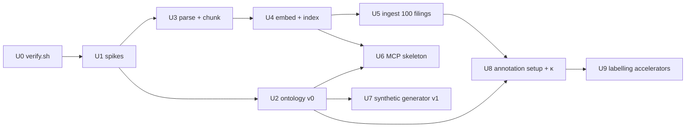

# Week 6–7 catch-up plan

Finish the starting work from the Milestone 2 timeline (§8.3, Weeks 6 and 7) so Week 8 retrieval experiments (E1, E2) have an index, an ontology and gold-set tooling to run on. Status on 19 Nov 2026 is that the architecture doc, repo skeleton, CI, schemas and EDGAR crawler exist. Ontology v0, ingestion past download, synthetic generator, annotation guide, MCP skeleton and the κ pilot do not.

Units in order are U0 to U9. U0 and U1 are scaffold and spikes. U2 to U9 each ship one capability with its own evidence.

## How to read this

One box is one unit of work. Check a box only when its evidence exists, such as a test run, a log line, a file or a commit SHA.

Every unit ends with `bash scripts/verify.sh` printing `==> ALL GATES GREEN`, plus one run against real data. Tests alone do not count as done.

**Roles.** Opus orchestrates, writes each worker brief, reviews every diff and runs the final verification. Sonnet writes code and prose. Haiku does mechanical edits and data runs. No worker commits. The orchestrator commits each unit on branch `catchup/week6-7` and pushes nothing without the operator's word.

**Limits.** At most 100 changed source lines per commit, so larger units land as two or three commits. Code stays in the existing `src/tarot/<module>/` layout, not `features/`. On this machine `uv` needs `--system-certs` because of the corporate TLS proxy. It is set through the environment, never hard-coded.

## Dependency graph

U2 and U3 run in parallel. U6, U7 and U8 run in parallel once their parents land.

## U0. Add the verify gate

**Model.** Haiku.

- [ ] Create `scripts/verify.sh` that runs `uv sync --locked`, `ruff check`, `ruff format --check` and `pytest`, stops on the first failure, and prints `==> ALL GATES GREEN` last.
- [ ] Evidence. The script prints the green line on current `main`, and fails when a lint error is planted.

## U1. Settle four open questions by spike

**Model.** Sonnet. Throwaway code in the scratchpad, nothing committed. Findings go to Appendix A.

- [ ] Docling on EDGAR exhibits. Parse three real EX-3.1 and EX-4 files with Docling. Record whether `Article` and `Section` headings come through as structure and whether character offsets into the exported text are stable. If structure is lost, U3 falls back to a heading regex over the plain text.
- [ ] Embedding runtime. Load Qwen3-Embedding-0.6B locally with `sentence-transformers` (CPU or Apple MPS). Record load time and seconds per 100 chunks.
- [ ] MCP SDK v2. Install `mcp` v2, run a stateless `MCPServer` with one tool over stdio and streamable HTTP, and call it from the SDK client. If it fails, repeat with FastMCP 4.
- [ ] Clause coverage. In 20 crawled filings, count the headings for each of the five clause types. If drag-along or board composition is rare, U5 widens the crawler to voting agreements (often EX-10 exhibits).

## U2. Write ontology v0

**Model.** Sonnet. **Files.** `src/tarot/ontology/clauses.py`, `src/tarot/ontology/patterns.py`, `tests/test_ontology.py`. **Adds.** `networkx`.

Data shape first. One Pydantic model per core clause type, joined as a discriminated union on `clause_type`. The extractor output (Week 9), generator labels (U7) and gold annotations (U8, U9) all use this one type.

| Clause type | Attributes in v0 | NVCA default |
| --- | --- | --- |
| `liquidation_preference` | multiple, participating, cap | 1x, non-participating |
| `anti_dilution` | method (broad-based WA, narrow WA, full ratchet, none), pay_to_play | broad-based WA, no pay-to-play |
| `board_composition` | investor seats, common seats, independent seats | from the NVCA model |
| `drag_along` | trigger holders, thresholds, founder carve-outs | from the NVCA model |
| `protective_provisions` | listed veto matters, voting threshold | from the NVCA model |

- [ ] `BENCHMARK` maps each clause type to its NVCA default instance, so the rule engine compares against one source of truth.
- [ ] `HEADINGS` maps each clause type to the charter headings that usually introduce it. U9's pre-labeller and U1's coverage count read this one table.
- [ ] `patterns.py` builds a NetworkX graph from a literal table of patterns (for example full ratchet with no pay-to-play) and of query-expansion edges (drag-along to board composition). `match_patterns(clauses)` and `expand(clause_type)` are its only API.
- [ ] Evidence. Tests show invalid attribute combinations are rejected and that the full-ratchet pattern matches a hand-built clause list.

## U3. Parse and chunk documents

**Model.** Sonnet. **Files.** `src/tarot/ingest/parse.py`, `src/tarot/ingest/chunk.py`, tests. **Adds.** `tokenizers`. No Docling, per Appendix A.

- [ ] `parse.py` turns a raw `.htm` or `.txt` file into a `Document` plus its plain text and section headings with character offsets. HTML is stripped with the standard library. Headings come from one regex that requires a number, a capitalised title and a full stop, so cross-references do not match. Results are stored in SQLite at `data/tarot.db` and keyed by `document_id`, so a re-parse with an unchanged `content_hash` is skipped.
- [ ] `chunk.py` produces `Chunk` objects for variants C0 (recursive 512 tokens), C1 (one chunk per clause, split at 512 tokens) and C2 (C1 plus the deterministic header from §4.2). Spans index into the parsed text, which the existing `Chunk` validator already enforces. Token counts use the embedding model's tokenizer.
- [ ] Evidence. Tests cover a 1,500-token clause splitting into three chunks with contiguous spans. A run over three real exhibits prints chunk counts per variant and five sample C2 headers for the orchestrator to read.

C3 (LLM context) and C4 (late chunking) wait for E1 in Week 8.

## U4. Embed and index into Qdrant

**Model.** Sonnet. **Files.** `src/tarot/ingest/index.py`, `src/tarot/ingest/__main__.py`, tests. **Adds.** `qdrant-client`, `sentence-transformers` (embeddings run locally on MPS, batch 16). CPU is about 30 times slower, so ingestion refuses to run bulk jobs without MPS or CUDA. The full 100-filing index is a one-off run of roughly an hour.

- [ ] One collection per chunking variant, named `chunks_c0`, `chunks_c1`, `chunks_c2`. The point ID is the existing `chunk_id` UUID, so upserts are idempotent. The payload carries `document_id`, `section_path`, span, `content_hash` and the EDGAR metadata.
- [ ] `python -m tarot.ingest data/raw/edgar` parses, chunks, embeds, upserts and writes a `Manifest` to `data/manifests/<snapshot_id>.json`.
- [ ] Evidence. Against the docker-compose Qdrant, the point count equals the manifest `chunk_count`, and a second run leaves the count and the snapshot ID unchanged.

Sparse vectors and fusion are Week 8. The collections can be rebuilt from SQLite, so adding them later costs a re-index and no migration.

## U5. Ingest 100 filings

**Model.** Haiku runs the commands. The orchestrator checks the output.

- [ ] Tighten the crawler first, per Appendix A. Keep "Amended and Restated Certificate of Incorporation" exhibits that contain preferred-stock terms. Skip certificates of designations, certificates of amendment and "Form of" charters. Drop near-duplicate refilings from the same company. Add voting-agreement exhibits (often EX-10) so drag-along clauses exist.
- [ ] Run `python -m tarot.ingest.crawler --limit 100` with the team's `SEC_USER_AGENT` from `.env`.
- [ ] Run `python -m tarot.ingest data/raw/edgar`.
- [ ] Evidence. `index.csv` has 100 rows, the Qdrant count matches the manifest, and the manifest is committed under `data/manifests/`.

## U6. Stand up the MCP server with three tools

**Model.** Sonnet. **Files.** `src/tarot/mcp_server/server.py`, `tests/test_mcp_server.py`. **Adds.** `mcp>=2.3` with `MCPServer`, per Appendix A. Tests use the in-process client, no subprocess.

- [ ] Tools are `ingest_document` (U3 and U4 on one file), `search_document` (dense search filtered to one `document_id`, hybrid arrives in Week 8) and `query_graph` (U2). Input and output schemas come from the existing Pydantic models.
- [ ] Stateless, streamable HTTP and stdio, as in §5.5.
- [ ] Evidence. A test drives all three tools through the SDK client over stdio. A manual run calls `search_document` over HTTP against the U5 index and returns chunks from the named document only.

## U7. Write the synthetic term sheet generator v1

**Model.** Sonnet. **Files.** `src/tarot/synthetic/` (`python -m tarot.synthetic`), `tests/test_synthetic.py`. Moved into the package so tests import it.

- [ ] Samples attribute values per clause type from the U2 models, renders each clause from two or three hand-written phrasings per alternative, and writes `<id>.txt` plus `<id>.labels.json` to `data/synthetic/term_sheets/`. Labels are U2 instances, so they validate by construction.
- [ ] Seeded. The same seed produces byte-identical output.
- [ ] Evidence. A test checks the seed rule and that every label span quotes its own clause text. A 50-document run is spot-read by the orchestrator.

The paraphrase pass with an open model (D4 in §1.3) is v2, in Week 9 with LoRA training.

## U8. Set up annotation and the κ pilot

**Model.** Sonnet. Opus reviews the guide before the team uses it.

- [ ] `docs/annotation-guide.md` covers the five clause types and their attributes from U2, span rules (what to include, how to handle cross-references and definitions), NVCA footnote pointers and three worked examples from U5 filings.
- [ ] Add a `label-studio` service to `docker-compose.yml` and a labelling config at `data/golden/g1_extraction/label_config.xml` with one span label per clause type and per-span attribute fields from U2.
- [ ] `scripts/select_filings.py` picks 30 U5 filings so each clause type has about 30 instances, using U1's heading counts. The first 5 are the pilot. IDs go to `data/golden/g1_extraction/pilot.txt` and `main.txt`.
- [ ] `scripts/kappa.py` reads two annotators' Label Studio JSON exports and reports character-level Cohen's κ on clause type, with "none" as a label, plus per-type agreement. Pure Python, no new dependency.
- [ ] Evidence. A test checks κ against a hand-computed example. A pilot filing loads in Label Studio and its export parses.
- [ ] Team work, not agent work. Both annotators label the 5 pilot filings independently with no pre-labels. κ must reach 0.7 before U9's pre-labels are used.

## U9. Build the labelling accelerators

**Model.** Sonnet. **Files.** `src/tarot/golden/prelabel.py`, `prelabel_recall.py`, `g2.py`, `tests/test_golden_accel.py`.

- [ ] `prelabel_headings.py` matches the U2 `HEADINGS` table against each parsed filing and writes Label Studio pre-annotations (clause type and span, no attributes) for the 25 non-pilot filings only.
- [ ] `generate_g2_questions.py` turns finished G1 labels into factoid and benchmark-comparison G2 rows, with the answer and supporting span taken from the human label. People write the multi-hop, precedent and unanswerable questions, about 100.
- [ ] Safeguard 1. Run the pre-labeller on the 5 pilot filings and score it against the human labels. If span recall is below 0.8, annotators label from scratch.
- [ ] Safeguard 2. A second annotator also labels 3 of the 25 single-annotated filings. κ there must stay at or above 0.7.
- [ ] Evidence. Tests cover heading matches on a fixture filing and question generation from a fixture label. Pre-labels import into Label Studio without errors.

Labelling scheme in short. Pilot 5 filings double-annotated by hand. The other 25 single-annotated from heading pre-labels, with every span confirmed and every attribute filled by a person. Half of G2 generated from G1 labels. Estimated effort is about 3 person-days for G1 and G2 together, an estimate and not measured.

## Close

- [ ] Every box above is checked with its evidence.
- [ ] Update the status table in the reply to the operator. Week 6 and Week 7 items are done except the κ pilot result, which waits on the two human annotators.

## Appendix A. Spike results

Run 19 Nov 2026 on an Apple M4 with 16 GB RAM. Scripts stay in the session scratchpad, not the repo.

**Docling (measured on 3 exhibits).** Docling found no usable headings. TomoTherapy gave 63 heading items with empty text, Barnes & Noble gave none, and `.txt` input is read as Markdown and turns indented `ARTICLE` lines into code blocks. A stdlib HTML strip plus a heading regex keeps run-in headings like "Section 1.5 Liquidation." but also matches cross-references at wrapped line starts, so the regex must require a number, a capitalised title and a full stop. Both take under 0.2 s per file. Decision for U3 is to drop Docling.

**Embeddings (measured).** Qwen3-Embedding-0.6B on MPS embeds 100 chunks of about 350 tokens in a median 15.3 s (batch 8) or 15.4 s (batch 32), 1024 dimensions, 618 MB peak RSS. CPU is about 30 times slower (20 chunks in 98.6 s) and is not usable for bulk ingestion. Downloading from Hugging Face needs `HF_HUB_DISABLE_XET=1`, download timeouts and a retry. The `tokenizers` package alone loads the model's tokenizer without torch.

**MCP SDK (measured).** `mcp` 2.3.0 ships `MCPServer` at `mcp.server.mcpserver` and lists protocol `2026-07-28`. One server answered the same tool calls over stdio and streamable HTTP (`stateless_http=True`, endpoint `/mcp`). A Pydantic return type produces `outputSchema` and `structured_content`. FastMCP is not needed.

**Coverage of the first 20 crawled exhibits (measured, keyword counts).**

| Kind | Count | Use for G1 |
| --- | --- | --- |
| Full pre-IPO VC charters | 8, including one duplicate pair | Yes |
| Private-equity or spin-off preferred | 6 | Weak |
| Certificates of designations or amendments | 6 | No |

Liquidation terms appear in 20 files, anti-dilution in 13, board election in 12, protective provisions in 9 and drag-along in none. Three near-duplicate pairs come from S-1/A refilings of the same exhibit.

## Appendix A2. Status on 19 Nov 2026

| Unit | Commit | Evidence |
| --- | --- | --- |
| U0 | `198411c`, `a552422` | `verify.sh` green, fails on a planted lint error, keeps the embed extra |
| U1 | `7412a0d` | Appendix A |
| U2 | `1d15441` | 10 ontology tests, multi-series pattern fix |
| U3 | `23b079c`, `b72c7b6` | 20 real filings parsed and chunked, second run skips all 20 |
| U4 | `0d7565d` | 3,531 chunks embedded in 12.7 min on MPS, rerun embeds 0 |
| U5 | `4e7ba72` | 105 filings crawled (75 charters, 30 voting agreements, 89 rejected). Indexing into docker Qdrant in progress |
| U6 | `172b099` | Live HTTP ingest and search against docker Qdrant, upload-dir guard |
| U7 | `dbea974` | Seeded output byte-identical, 50-document distribution checked |
| U8 | `2d8a1ea` | Label Studio up, config parsed by Label Studio, 5 + 25 filings selected |
| U9 | `987620f` | 36 pre-labels on 25 filings, pilot refused |

Open items. The κ pilot is human work. Heading pre-labels found only 1 anti-dilution region in 25 filings because the heading regex ignores lettered sub-headings such as "(e) Adjustments to Conversion Price", which also limits C1 chunking. Extending the regex is a Week 8 task alongside E1, followed by a `PARSER_VERSION` bump and a re-index.

## Appendix B. Choices made and alternatives rejected

- **Lean plan instead of the full pstack multi-PR template.** The template's ten live swarm lanes per PR, perf gates and an hourly audit loop are sized for UI products. This repo has no UI and these units are small, so one real-data run per unit gives the same proof for a small fraction of the agent runs.
- **One branch with one commit per unit, no PR per unit.** The repo commits straight to `main` today. Separate PRs can be cut later if the team wants review.
- **SQLite and files over a new service.** §2 already names SQLite. Qdrant and Label Studio are the only containers.
- **Embeddings run locally** with `sentence-transformers`, decided by the operator. The GPU server is only needed from Week 9 for LoRA training and vLLM.
- **Label Studio for annotation**, decided by the operator. Hand-typed JSONL offsets are error-prone.
- **Heading pre-labels, not model pre-labels.** Headings are free, deterministic and need no GPU. A model pre-labeller (Qwen3.6-27B) stays available if heading recall is poor. Extractors under test in E3 never pre-label.
- **No public dataset replaces G1.** CUAD, LEDGAR, MAUD and ACORD do not cover venture financing clauses with spans and attributes. The LEDGAR label overlap is not checked and is only worth checking if E3 shows clause type is the weak point.
- **Pay-to-play is an attribute of `anti_dilution` in v0.** It only matters through the full-ratchet pattern. It becomes its own clause type if annotators find it stands alone in filings.
- **Shieldstral screening is deferred to Week 11** with the other guardrails. Until then the crawler only fetches public SEC filings.

## Appendix C. Risks

| Risk | Unit | Watch |
| --- | --- | --- |
| Heading regex misses unusual charter layouts | U3 | Run it over all U5 filings and list files with fewer than 5 headings |
| Bulk embedding on a 16 GB laptop | U4, U5 | MPS only, one run, cached. Try fp16 if it is too slow |
| Drag-along and board seats missing from fetched exhibits | U5 | U1 coverage count. Widen the crawler to voting agreements |
| Docling and torch make CI slow | U3, U4 | Cache the uv environment in CI. Skip model-loading tests in CI if they exceed two minutes |
| MCP SDK v2 rough edges | U6 | FastMCP 4 fallback, decided in U1 |
| SEC rate limits during U5 | U5 | The crawler already throttles and retries. It resumes from `index.csv` |
| Annotators accept heading pre-labels without checking | U9 | Safeguards 1 and 2. E3 reports attribute accuracy separately from span detection |
| κ pilot slips | U8 | It is human work. Book the two annotators' time now |
